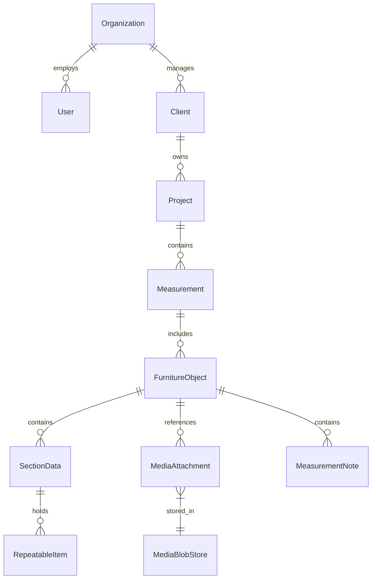

# Furniture Platform — Phase 1 Smart Measurement MVP
## Master Implementation Plan & Architectural Specification

**Document Version**: 1.1 (Post-Architectural Refinement)  
**Target Directory**: `Documents/My folder/AI/YaDima`  
**Status**: Ready for Execution

---

## Table of Contents
1. [Executive Summary & Long-Term Product Vision](#1-executive-summary--long-term-product-vision)
2. [Architectural Refinements & Core Decisions](#2-architectural-refinements--core-decisions)
   - Refinement 1: Measurement Domain Flexibility & Provisional Templates
   - Refinement 2: The Hybrid `FurnitureObject` Model
   - Refinement 3: Native Binary Media Storage Architecture
3. [Domain Model & Entity Specifications](#3-domain-model--entity-specifications)
4. [Provisional Measurement Templates & Configuration Engine](#4-provisional-measurement-templates--configuration-engine)
5. [Specialist Assumptions Requiring On-Site Validation](#5-specialist-assumptions-requiring-on-site-validation)
6. [Phase 1 MVP Scope & Boundaries](#6-phase-1-mvp-scope--boundaries)
7. [Technology Stack](#7-technology-stack)
8. [Concrete Step-by-Step Implementation Sequence](#8-concrete-step-by-step-implementation-sequence)
9. [Verification & Acceptance Plan](#9-verification--acceptance-plan)

---

## 1. Executive Summary & Long-Term Product Vision

### 1.1 The High-Level Mission
Custom, made-to-measure furniture businesses operate with high average order values ($3,000 to $50,000+) but suffer from thin margins caused by preventable site measurement mistakes, lost data across handoffs, and manual supplier ordering.

The long-term vision of **Furniture Platform** is to unite the entire business lifecycle into a continuous digital operating thread:

$$\text{Client / Lead} \to \text{Project} \to \mathbf{\text{Smart Measurement}} \to \text{Analysis} \to \text{Design} \to \text{Client Approvals} \to \text{Costing} \to \text{Supplier/Viyar} \to \text{Production} \to \text{Logistics} \to \text{Installation} \to \text{Warranty/CRM}$$

Eventually, the platform expands to include a customer-facing **Guided Furniture Configurator** (template-driven, not CAD) that feeds directly into this professional pipeline.

### 1.2 The Phase 1 MVP Focus: Smart Measurement
Our first working milestone is strictly focused on the **on-site field measurement workflow**:
- An intuitive, smartphone-first web application designed for a furniture specialist walking a property with a laser measure in one hand and a phone in the other.
- Captures **multiple furniture objects** in a single visit (e.g., Kitchen, Bathroom Cabinet, Wardrobe).
- 100% functional offline (local-first via IndexedDB), resilient in basements and construction sites with no cellular data.
- Instant, deterministic completeness scoring and risk detection before leaving the property.

---

## 2. Architectural Refinements & Core Decisions

Following architectural review, three critical refinements govern this implementation plan:

### Refinement 1: Measurement Domain Flexibility & Provisional Templates
- All initial field templates (`Kitchen`, `Bathroom Cabinet`, `Wardrobe`, `Other`) are treated as **provisional field hypotheses**.
- The core domain model does not depend on a static list of fields.
- Templates are pure declarative configuration objects that can be adjusted or added within minutes after testing with an active installer.

### Refinement 2: The Hybrid `FurnitureObject` Model
Rather than a rigid entity (`walls: Wall[]`, `appliances: Appliance[]`) or an untyped NoSQL dictionary (`data: Record<string, any>`), we adopt a **Hybrid Architecture**:
- `FurnitureObject` maintains a **neutral core identity** (`id`, `measurementId`, `objectTypeId`, `name`, `status`, `media`, `notes`, `completeness`).
- Measurement data is held in dynamic sections: `sections: Record<string, SectionData>`.
- Sections contain either **`parameters`** (scalar property bag) or **`items`** (repeatable entity collection).
- Strong TypeScript type safety is preserved via an extensible **Entity Payload Registry** (`EntityTypeMap`), ensuring compile-time autocomplete and safety for known sub-entities (`WallPayload`, `OpeningPayload`, `TechnicalPointPayload`, etc.) while keeping the container structure completely decoupled.

### Refinement 3: Native Binary Media Storage (Zero Base64 in Records)
- Photo data is **never stored as Base64 strings** inside domain JSON records (avoiding 33% bloat, memory spikes, and main thread freezing).
- `MediaAttachment` stores **lightweight metadata only** (`id`, `storageKey`, `storageProvider`, `mimeType`, `sizeBytes`, `tag`, `caption`).
- Binary images are saved as native `Blob` / `File` objects into a dedicated IndexedDB store (`fp_media_blobs`) via a clean `IMediaStorageService` port.
- In Phase 2, this exact abstraction connects to Supabase Storage or S3 with zero UI or domain changes.

---

## 3. Domain Model & Entity Specifications



### 3.1 Aggregate Roots & Entities

#### `Client`
```typescript
export interface Client {
  id: string;
  organizationId: string;
  firstName: string;
  lastName: string;
  phone: string;
  email?: string;
  preferredChannel: 'phone' | 'whatsapp' | 'telegram' | 'email';
  address: {
    street: string;
    city: string;
    postalCode: string;
    apartment?: string;
    floor?: number;
    hasElevator: boolean;
    accessNotes?: string;
  };
  notes?: string;
  createdAt: string;
  updatedAt: string;
}
```

#### `Project`
```typescript
export interface Project {
  id: string;
  organizationId: string;
  clientId: string;
  name: string;
  status:
    | 'NEW_LEAD'
    | 'MEASUREMENT_SCHEDULED'
    | 'MEASURED'
    | 'DESIGN'
    | 'WAITING_FOR_CLIENT'
    | 'ORDERED'
    | 'IN_PRODUCTION'
    | 'INSTALLATION'
    | 'COMPLETED';
  notes?: string;
  createdAt: string;
  updatedAt: string;
}
```

#### `Measurement`
```typescript
export interface Measurement {
  id: string;
  organizationId: string;
  projectId: string;
  specialistId: string;
  specialistName: string;
  measurementDate: string;
  status: 'DRAFT' | 'IN_PROGRESS' | 'COMPLETED';
  generalNotes?: string;
  overallCompletenessPct: number;
  objects: FurnitureObject[];
  createdAt: string;
  updatedAt: string;
}
```

#### `FurnitureObject` (Hybrid Model)
```typescript
export interface FurnitureObject {
  id: string;
  measurementId: string;
  objectTypeId: string;                // References FurnitureObjectTemplate.id
  name: string;                        // e.g. "Main Kitchen Wall & Island"
  status: 'DRAFT' | 'COMPLETED';
  sections: Record<string, SectionData>; // Keyed by section_id from template
  media: MediaAttachment[];            // Metadata references only
  notes: MeasurementNote[];
  completeness: CompletenessReport;
  createdAt: string;
  updatedAt: string;
}

export interface SectionData {
  sectionId: string;
  parameters?: Record<string, unknown>; // Scalar fields
  items?: RepeatableItem[];             // Repeatable collection
}

export interface RepeatableItem<T = unknown> {
  id: string;
  entityType: string;                   // 'wall' | 'opening' | 'technical_point' | 'appliance' | 'custom'
  payload: T;
}
```

#### Sub-Entity Payloads (Extensible Registry)
```typescript
export interface WallPayload {
  identifier: string;         // e.g. "Wall A (Main)"
  lengthMm: number;          // Floor-level measurement
  lengthMiddleMm?: number;   // 1000mm level (bow check)
  lengthTopMm?: number;      // Ceiling level
  heightLeftMm: number;
  heightRightMm: number;
  cornerAngleDeg?: number;   // e.g. 90.0°, 88.5°
  plumbDeviationMm?: number; // Vertical tilt over 2m
  notes?: string;
}

export interface OpeningPayload {
  wallRef: string;
  type: 'window' | 'door' | 'niche' | 'radiator' | 'vent_shaft' | 'structural_beam' | 'pipe_riser';
  widthMm: number;
  heightMm: number;
  distanceFromCornerMm: number;
  sillHeightMm?: number;
  projectionDepthMm?: number; // Radiator protrusion
  notes?: string;
}

export interface TechnicalPointPayload {
  wallRef: string;
  type:
    | 'socket_230v'
    | 'socket_400v'
    | 'water_cold'
    | 'water_hot'
    | 'drain_pipe'
    | 'gas_pipe'
    | 'ventilation_duct'
    | 'light_switch'
    | 'thermostat';
  distanceFromCornerMm: number;
  heightFromFloorMm: number;
  diameterMm?: number;       // For 50mm drain or 150mm duct
  isRelocatable: boolean;
  notes?: string;
}

export interface AppliancePayload {
  type:
    | 'refrigerator'
    | 'oven'
    | 'microwave'
    | 'hob'
    | 'hood'
    | 'dishwasher'
    | 'sink'
    | 'washing_machine'
    | 'dryer'
    | 'other';
  status: 'existing' | 'purchasing_new' | 'supplied_by_us';
  brandModel?: string;
  widthMm?: number;
  depthMm?: number;
  heightMm?: number;
  notes?: string;
}
```

#### `MediaAttachment` (Metadata Only)
```typescript
export interface MediaAttachment {
  id: string;
  organizationId: string;
  storageKey: string;              // e.g. "blobs/media-uuid-001.jpg"
  storageProvider: 'local_indexeddb' | 'supabase_storage' | 's3';
  fileName: string;
  mimeType: string;                // "image/jpeg", "image/png"
  sizeBytes: number;
  tag: 'room_overview' | 'wall' | 'opening' | 'technical' | 'appliance' | 'defect';
  caption?: string;
  createdAt: string;
}
```

---

## 4. Provisional Measurement Templates & Configuration Engine

### 4.1 Declarative Template Specification
```typescript
export interface FurnitureObjectTemplate {
  id: string;
  name: string;
  description: string;
  icon: string;
  sections: SectionDefinition[];
  completenessRules?: {
    requiredEntityTypes?: string[];
    requiredAppliances?: string[];
    angleCheckEnabled?: boolean;
  };
}

export interface SectionDefinition {
  id: string;
  title: string;
  shortLabel: string;
  icon: string;
  kind: 'parameters' | 'collection';
  weight: number;
  fields?: FieldDefinition[];
  entityType?: string;
  minItems?: number;
}
```

### 4.2 Initial Template Configurations
1. **`KITCHEN` Template**:
   - `general` (parameters: room shape, ceiling height, floor condition, wall material)
   - `walls` (collection: `wall` with corner angles and lengths)
   - `openings` (collection: `opening` with windows, radiators, projection depths)
   - `technical` (collection: `technical_point` with water cold/hot, drain, 400V stove power, hood duct)
   - `appliances` (collection: `appliance` with hob, oven, fridge, hood, sink, dishwasher)
   - `media` & `notes`
2. **`BATHROOM_CABINET` Template**:
   - `general` (parameters: alcove width, tile boundary height)
   - `walls` (collection: `wall`)
   - `technical` (collection: `technical_point` with cold/hot feeds, drain height/diameter, mirror light wire)
   - `appliances` (collection: `appliance` with basin type, faucet type, siphon space)
   - `media` & `notes`
3. **`WARDROBE` Template**:
   - `general` (parameters: niche vs straight, crown molding, baseboard depth)
   - `walls` (collection: `wall` with floor, mid, top widths)
   - `openings` (collection: `opening` with door swings, bulkheads)
   - `technical` (collection: `technical_point` with enclosed sockets, LED transformer feeds)
   - `media` & `notes`
4. **`OTHER` Template**:
   - Generic space parameters, dimensions, utility feeds, photos, and notes.

---

## 5. Specialist Assumptions Requiring On-Site Validation

During upcoming field tests with the active furniture installer, the following 8 assumptions must be specifically validated:

| # | Topic | Current Hypothesis in System | Open Question for Specialist |
|---|---|---|---|
| **1** | **Datum & Coordinate Origin** | Openings & utilities measured as linear distance along wall from left corner. | Do you measure from nearest corner, single master room origin $(0,0)$, or relative to adjacent cabinetry? |
| **2** | **Vertical Reference Datum** | Heights measured from physical floor at point of measurement. | When floors are unfinished screed or sloped, do you measure from the physical floor or establish a laser level benchmark (+1.000m mark)? |
| **3** | **Corner Angles & Squareness** | Angles measured in degrees ($88.5^\circ$) using digital angle finder. | Do you use digital angle gauges, or measure the diagonal hypotenuse (3-4-5 triangle method)? |
| **4** | **Wall Bowing / Plumb** | Single floor length primary; middle/top checks optional. | For full-height wardrobes, do you always measure 3 widths (floor, 1.2m, ceiling) and 2 depths, or is one width plus plumb check enough? |
| **5** | **Appliance Specs on Site** | Specialist records exact brand/model and dimensions. | How often does the client have purchased appliances on site vs. requesting standard 600mm / 450mm module placeholders? |
| **6** | **Drain & Plumbing Traps** | Drain height measured to center of pipe outlet. | Do you need center-to-floor, bottom-to-floor, or pipe projection from wall (to avoid drawer clash)? |
| **7** | **Room vs. Object Geometry** | Each Furniture Object defines its own walls. | In open spaces (e.g. kitchen + entryway wardrobe), is it faster to measure the room perimeter once, or measure each furniture zone independently? |
| **8** | **Window Sill Clearances** | Windows record sill height and radiator projection. | Do you need sash swing radius and handle projection to ensure sink faucets don't block window opening? |

---

## 6. Phase 1 MVP Scope & Boundaries

### In Scope for Phase 1
- **Smartphone-First Web Application**: Fully responsive touch UI optimized for single-handed field use.
- **Client & Project Selection**: Fast selection of existing clients/projects or instant 1-tap on-site creation.
- **Multi-Object Measurement Visits**: Measure multiple furniture items in one session (Kitchen, Bathroom, Wardrobe, Other).
- **Provisional Section Forms**: Dynamic forms rendering scalar parameters and repeatable collections (walls, openings, technical utilities, appliances).
- **Native Binary Photo Capture**: Native browser camera integration storing binary Blobs in IndexedDB (zero Base64 in JSON).
- **Deterministic Completeness Engine**: Real-time score calculation (0–100%) and actionable checklist (Missing items, Warnings, Verified checks).
- **Measurement Summary & Review**: Comprehensive multi-object review card.
- **Structured CAD/Constructor Export**: Downloadable standard JSON package conforming to `MeasurementExportPackage`, plus printable summary view.
- **Local Persistence & Seed Data**: Pre-loaded with realistic demo client, project, and measurement session.

### Explicitly Deferred to Future Phases
- Cloud database / Supabase servers (Phase 2).
- User authentication and role-based permissions (Phase 2).
- AI computer vision and voice memo transcription (Phase 3).
- Proprietary CAD/CAM direct plugins (Phase 4).
- Viyar live catalog / ordering API (Phase 5).
- Client self-service 3D configurator and pricing engine (Phase 7–9).

---

## 7. Technology Stack

| Layer | Technology | Rationale |
|---|---|---|
| **Frontend Framework** | **React 18/19 + TypeScript + Vite** | Lightweight, instant HMR, zero server overhead, PWA ready. |
| **Styling & Icons** | **Tailwind CSS + Lucide Icons** | Large 48px+ touch targets, ergonomic numeric keyboards, native feel. |
| **Local Persistence** | **IndexedDB (`idb-keyval` + custom Blob Store)** | 100% offline, durable local storage, zero latency in concrete basements. |
| **Ports & Adapters** | **Hexagonal Clean Architecture** | Decouples UI and domain from storage and external APIs. |
| **Validation** | **Zod / Pure TypeScript Guards** | Runtime validation for export packages and schema integrity. |

---

## 8. Concrete Step-by-Step Implementation Sequence

1. **Scaffold Directory Structure & Configuration**:
   - Set up `package.json`, `tsconfig.json`, `vite.config.ts`, `tailwind.config.js`, `postcss.config.js`, and `index.html`.
2. **Domain Core Layer (`src/domain/`)**:
   - Types: `Client`, `Project`, `Measurement`, `FurnitureObject` (Hybrid Model), `MediaAttachment`, `MeasurementNote`.
   - Entity Payload Registry: `WallPayload`, `OpeningPayload`, `TechnicalPointPayload`, `AppliancePayload`.
   - Declarative Template Specification: `FurnitureObjectTemplate`, `SectionDefinition`, `FieldDefinition`.
   - Provisional Templates: `kitchenTemplate`, `bathroomTemplate`, `wardrobeTemplate`, `otherTemplate`, `registry`.
   - Completeness Engine: `evaluateObjectCompleteness` & `calculateOverallMeasurementCompleteness`.
   - Port Interfaces: `IMeasurementRepository`, `IMediaStorageService`, `IDesignSoftwareAdapter`, `ISupplierAdapter`.
3. **Infrastructure Layer (`src/infrastructure/`)**:
   - `IndexedDbMeasurementRepository`: Implements `IMeasurementRepository` with default seed data.
   - `IndexedDbMediaStorageService`: Implements `IMediaStorageService` storing raw binary `Blob` objects.
   - `JsonDesignSoftwareAdapter`: Implements `IDesignSoftwareAdapter` for CAD export.
4. **Application Layer (`src/application/`)**:
   - `useClientsAndProjects`: Hook for client/project lookup and on-site creation.
   - `useMeasurementSession`: Hook orchestrating active measurement, object lifecycle, auto-saving, and completeness recalculation.
5. **UI Presentation Layer (`src/ui/`)**:
   - Touch Primitives: `MobileHeader`, `NumericInput`, `SegmentedPicker`, `CompletenessBadge`, `TouchCard`.
   - Photo Uploader: `PhotoUploader` using `IMediaStorageService` (native Blobs and `URL.createObjectURL`).
   - Dynamic Section Forms: `GeneralSectionForm`, `WallsSectionForm`, `OpeningsSectionForm`, `TechnicalSectionForm`, `AppliancesSectionForm`, `NotesSectionForm`.
   - Views:
     - `DashboardView`: Recent visits, projects, clients, and prominent "+ New Measurement" button.
     - `ClientProjectModal`: Select existing or create on the fly.
     - `MeasurementOverviewView`: Multi-object carousel, overall completeness bar, "+ Add Object".
     - `ObjectEditorView`: Dynamic section tabs, live completeness bar, prev/next navigation.
     - `MeasurementSummaryView`: Multi-object breakdown, quality/risk checklist, JSON download, printable summary.
6. **Root Orchestration (`src/App.tsx`, `src/main.tsx`)**:
   - Wire all views and session state into a smooth mobile flow.

---

## 9. Verification & Acceptance Plan

### 9.1 Verification Checklist
- **Mobile Ergonomics**: Tested at 390×844 viewport (iPhone 14/15 profile). All interactive touch targets $\ge 48\text{px}$.
- **Multi-Object Verification**: Create a measurement visit with both a Kitchen and a Bathroom Cabinet; verify distinct section fields and independent completeness scores.
- **Offline Persistence**: Enter data, refresh the browser, and confirm 100% of data is restored from IndexedDB.
- **Binary Media Verification**: Attach a photo, inspect IndexedDB, and verify it is stored as a binary Blob in `fp_media_blobs` and referenced only by key in the measurement JSON.
- **CAD/Constructor Package**: Download the exported JSON package and verify valid schema version, project metadata, coordinates, and object summaries.
