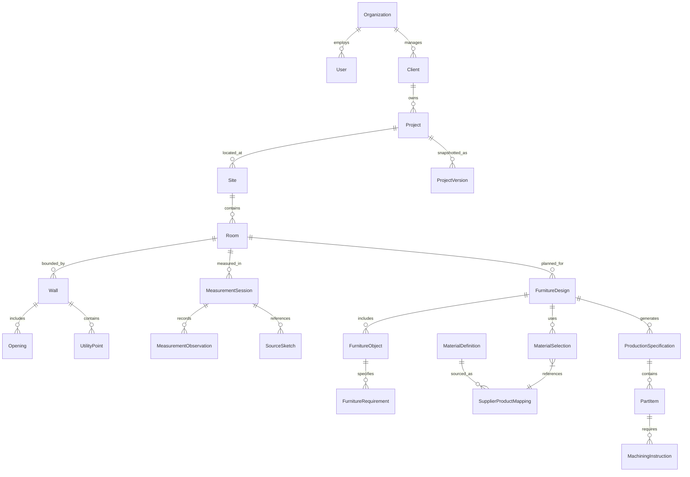

# Room-to-Production Platform — Canonical Data Model

## 1. Entity-Relationship Overview



---

## 2. Core Entities (Multi-Tenancy & Project Hierarchy)

### `Organization` (Multi-Tenancy Anchor)
```typescript
export interface Organization {
  id: string;                 // Stable internal UUID
  name: string;               // e.g. "Firma YADIMA"
  createdAt: string;          // ISO timestamp
}
```

### `Client`
```typescript
export interface Client {
  id: string;
  organizationId: string;
  firstName: string;
  lastName: string;
  phone: string;
  email?: string;
  preferredChannel: 'phone' | 'whatsapp' | 'telegram' | 'email';
  notes?: string;
  createdAt: string;
  updatedAt: string;
}
```

### `Project`
```typescript
export interface Project {
  id: string;
  organizationId: string;
  clientId: string;
  name: string;               // e.g. "Marszałkowska 10 - Kitchen & Hallway"
  roomVerificationState: 'DRAFT' | 'MEASUREMENT_IN_PROGRESS' | 'AI_PROCESSED' | 'HUMAN_REVIEW_REQUIRED' | 'ROOM_VERIFIED';
  furnitureDesignState: 'CONCEPT' | 'IN_REVIEW' | 'CLIENT_APPROVED' | 'DESIGN_FROZEN';
  productionExportState: 'UNPREPARED' | 'SPEC_GENERATED' | 'READY_FOR_EXPORT' | 'EXPORTED';
  siteId?: string;
  notes?: string;
  createdAt: string;
  updatedAt: string;
}
```

### `Site` & `Address`
```typescript
export interface Site {
  id: string;
  organizationId: string;
  projectId: string;
  street: string;
  city: string;
  postalCode: string;
  apartment?: string;
  floor?: number;
  hasElevator: boolean;
  accessNotes?: string;       // e.g. "Gate code #1423, park in courtyard"
  createdAt: string;
}
```

---

## 3. Tier A: Canonical Room / Spatial Model ("What exists in the physical space?")

### `Room`
```typescript
export interface Room {
  id: string;
  organizationId: string;
  projectId: string;
  name: string;               // e.g. "Main Kitchen", "Master Bedroom"
  roomType: 'kitchen' | 'bathroom' | 'wardrobe_room' | 'living_room' | 'hallway' | 'office' | 'other';
  floorLevelMm?: number;      // Datum offset from site benchmark (+0.000)
  ceilingHeightMm: number;    // Nominal ceiling height
  ceilingHeightMinMm?: number;// Lowest point if ceiling slopes
  ceilingHeightMaxMm?: number;// Highest point
  floorCondition: 'finished_tile' | 'finished_wood' | 'raw_screed' | 'slanted';
  walls: Wall[];
  structuralObstacles?: StructuralObstacle[];
  createdAt: string;
  updatedAt: string;
}
```

### `Wall`
```typescript
export interface Wall {
  id: string;
  roomId: string;
  identifier: string;         // e.g. "Wall A", "Wall B (Window side)"
  sequenceIndex: number;      // 0, 1, 2... clockwise around room perimeter
  lengthBaseMm: number;       // Measured at floor level
  lengthMiddleMm?: number;    // Measured at 1000mm height (bow/convexity check)
  lengthTopMm?: number;       // Measured at ceiling level
  heightLeftMm: number;
  heightRightMm: number;
  cornerAngleDeg?: number;    // Measured angle to next wall (e.g. 90.0°, 88.5°)
  plumbDeviationMm?: number;  // Vertical wall lean over 2000mm (+ lean out, - lean in)
  material: 'concrete' | 'brick' | 'drywall_single' | 'drywall_double' | 'aerated_concrete' | 'unknown';
  openings: Opening[];
  utilityPoints: UtilityPoint[];
  provenance: Provenance;
}
```

### `Opening` (Doors, Windows, Niches, Bulkheads)
```typescript
export type OpeningType =
  | 'window'
  | 'door'
  | 'niche'
  | 'radiator'
  | 'vent_shaft'
  | 'structural_beam'
  | 'pipe_riser';

export interface Opening {
  id: string;
  wallId: string;
  type: OpeningType;
  distanceFromWallStartMm: number; // Distance from left corner along wall baseline
  widthMm: number;
  heightMm: number;
  sillHeightMm?: number;          // Floor-to-sill height (windows, niches)
  projectionDepthMm?: number;     // Extrusion into room (radiators, beams, sills)
  notes?: string;
  provenance: Provenance;
}
```

### `UtilityPoint` (Electrical, Plumbing, HVAC)
```typescript
export type UtilityType =
  | 'socket_230v'
  | 'socket_400v'
  | 'water_cold'
  | 'water_hot'
  | 'drain_pipe'
  | 'gas_pipe'
  | 'ventilation_duct'
  | 'light_switch'
  | 'thermostat'
  | 'underfloor_heating_box';

export interface UtilityPoint {
  id: string;
  wallId: string;
  type: UtilityType;
  distanceFromWallStartMm: number; // X coordinate along wall baseline
  heightFromFloorMm: number;       // Y coordinate above floor
  depthProjectionMm?: number;      // Projection from wall face
  diameterMm?: number;             // For drains (e.g. 50mm) or ducting (e.g. 125mm)
  isRelocatable: boolean;          // Can the installer or client move this feed?
  notes?: string;
  provenance: Provenance;
}
```

---

## 4. Measurement Capture, Provenance & AI Safety

### `Provenance` (Source of Truth Tracking)
```typescript
export type SourceType =
  | 'manual_laser'
  | 'manual_tape'
  | 'photo_derived'
  | 'hand_drawn_sketch'
  | 'file_imported'
  | 'ai_detected'
  | 'user_corrected';

export interface Provenance {
  sourceType: SourceType;
  sourceRefId?: string;       // References MediaAttachment.id or SourceSketch.id
  confidenceScore?: number;   // 0.00 to 1.00 (if AI detected)
  verificationStatus: 'unverified' | 'confirmed' | 'corrected' | 'rejected';
  verifiedBy?: string;        // Specialist user ID
  verifiedAt?: string;        // ISO timestamp
  correctionNotes?: string;
}
```

### `SourceSketch` (Hand-Drawn Measurement Sketches)
```typescript
export interface SourceSketch {
  id: string;
  roomId: string;
  mediaAttachmentId: string;  // References raw binary Blob in storage
  authorName?: string;
  drawnAt?: string;
  annotations?: Array<{
    xPct: number;             // Relative coordinates on sketch image (0-100%)
    yPct: number;
    text: string;
    targetElementRef?: string;
  }>;
  createdAt: string;
}
```

---

## 5. Tier B: Furniture Design Model ("What do we want to build?")

### `FurnitureDesign` & `FurnitureObject`
```typescript
export interface FurnitureDesign {
  id: string;
  organizationId: string;
  roomId: string;             // References canonical Room
  version: number;
  name: string;               // e.g. "Kitchen Layout Option A"
  objects: FurnitureObject[];
  materialSelections: MaterialSelection[];
  createdAt: string;
  updatedAt: string;
}

export interface FurnitureObject {
  id: string;
  designId: string;
  objectTypeId: string;       // References template (e.g. 'kitchen_island', 'tall_cabinet_run')
  name: string;               // e.g. "Main Sink & Cooking Run"
  wallReferences: string[];   // Associated wall IDs in the Room
  bounds: {
    startMm: number;          // Position along reference wall
    widthMm: number;
    depthMm: number;
    heightMm: number;
  };
  requirements: FurnitureRequirement[];
  sections: Record<string, unknown>; // Configuration-driven parameters/items
  status: 'DRAFT' | 'APPROVED';
}

export interface FurnitureRequirement {
  id: string;
  category: 'appliance' | 'ergonomics' | 'storage' | 'client_preference';
  description: string;
  applianceType?: string;     // e.g. 'dishwasher_60cm'
  isMandatory: boolean;
}
```

---

## 6. Tier C: Production Model ("How will the design be manufactured?")

### `ProductionSpecification` & `PartItem`
```typescript
export interface ProductionSpecification {
  id: string;
  organizationId: string;
  designId: string;           // References FurnitureDesign
  supplierId: string;         // e.g. "viyar_poland", "local_carpentry"
  exportFormat: 'viyar_project' | 'generic_dxf' | 'generic_json' | 'generic_xml';
  parts: PartItem[];
  fittings: FittingItem[];
  status: 'GENERATED' | 'VALIDATED' | 'EXPORTED';
  generatedAt: string;
}

export interface PartItem {
  id: string;
  partNumber: string;         // e.g. "CAB-01-LEFT-SIDE"
  furnitureObjectId: string;
  materialId: string;         // References internal MaterialDefinition
  supplierProductCode?: string; // Mapped code (e.g. Viyar SKU 48291)
  lengthMm: number;           // Grain direction dimension
  widthMm: number;
  thicknessMm: number;
  quantity: number;
  edgeBanding: {
    front?: string;           // e.g. "ABS 22x1 Halifax Oak"
    back?: string;
    left?: string;
    right?: string;
  };
  machiningInstructions?: MachiningInstruction[];
}

export interface MachiningInstruction {
  id: string;
  type: 'hinge_bore' | 'drawer_slide_drilling' | 'cam_lock' | 'groove_back_panel';
  face: 'A' | 'B' | 'EDGE_TOP' | 'EDGE_BOTTOM' | 'EDGE_LEFT' | 'EDGE_RIGHT';
  xMm: number;
  yMm: number;
  diameterMm?: number;
  depthMm?: number;
}
```

---

## 7. Provider-Neutral Material Catalog

### 4-Tier Material Abstraction
```
Tier 1: Manufacturer Material (e.g. EGGER H1180 ST37 Natural Halifax Oak)
  │
  ▼ mapped to
Tier 2: Supplier Product (e.g. Viyar Chipboard 18mm, SKU 59281)
  │
  ▼ selected for
Tier 3: Project Material Selection (e.g. Selected for "Lower Cabinet Fronts")
  │
  ▼ allocated to
Tier 4: Production Specification (e.g. Cut 716 x 596 x 18 mm + 1mm ABS edge)
```

```typescript
export interface MaterialDefinition {
  id: string;                 // Stable internal UUID
  manufacturer: string;       // e.g. "EGGER", "Kronospan", "Swiss Krono"
  manufacturerCode: string;   // e.g. "H1180 ST37"
  name: string;               // "Halifax Oak Natural"
  materialType: 'chipboard_melamine' | 'mdf_lacquered' | 'mdf_veneered' | 'compact_hpl' | 'solid_wood';
  thicknessOptionsMm: number[]; // [18, 19, 25]
  textureCategory: 'woodgrain' | 'stone' | 'solid_color' | 'metallic';
}

export interface SupplierProductMapping {
  id: string;
  materialDefinitionId: string;
  supplierName: string;       // e.g. "Viyar"
  supplierProductCode: string;// Supplier-specific SKU / catalog ID
  pricingPerSqm?: number;
  currency?: string;
  availability: 'in_stock' | 'to_order' | 'discontinued';
}

export interface MaterialSelection {
  id: string;
  designId: string;
  zoneOrRole: 'carcass' | 'fronts' | 'countertop' | 'back_panel' | 'accent';
  materialDefinitionId: string;
  supplierMappingId?: string;
  thicknessMm: number;
}
```

---

## 8. Versioning & Validation Snapshots

```typescript
export interface ProjectVersion {
  id: string;
  projectId: string;
  versionNumber: number;      // 1, 2, 3...
  label: string;              // e.g. "Initial Room Measurement Sign-off"
  roomSnapshot: Room[];       // Immutable deep freeze of room geometry
  designSnapshot?: FurnitureDesign;
  materialSnapshot?: MaterialSelection[];
  validationIssues: ValidationIssue[];
  frozenBy: string;
  frozenAt: string;
}

export interface ValidationIssue {
  id: string;
  severity: 'critical_blocker' | 'warning' | 'info';
  category: 'missing_dimension' | 'collision_risk' | 'out_of_square' | 'unverified_ai';
  message: string;
  elementRef?: string;        // Wall ID, Utility ID, or Cabinet ID
  isResolved: boolean;
}
```
